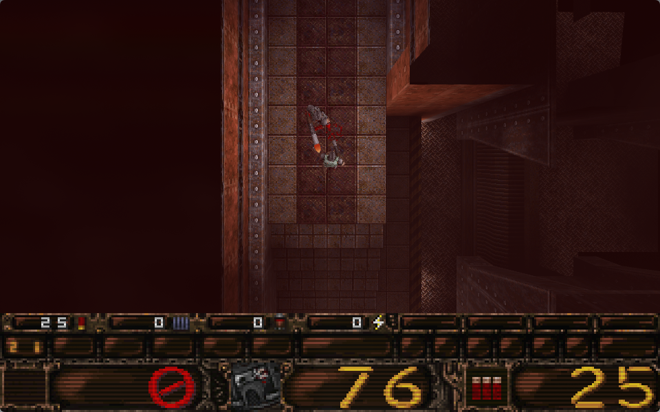
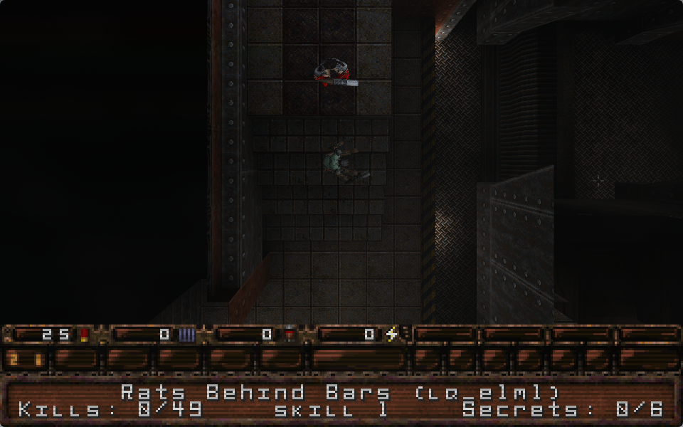
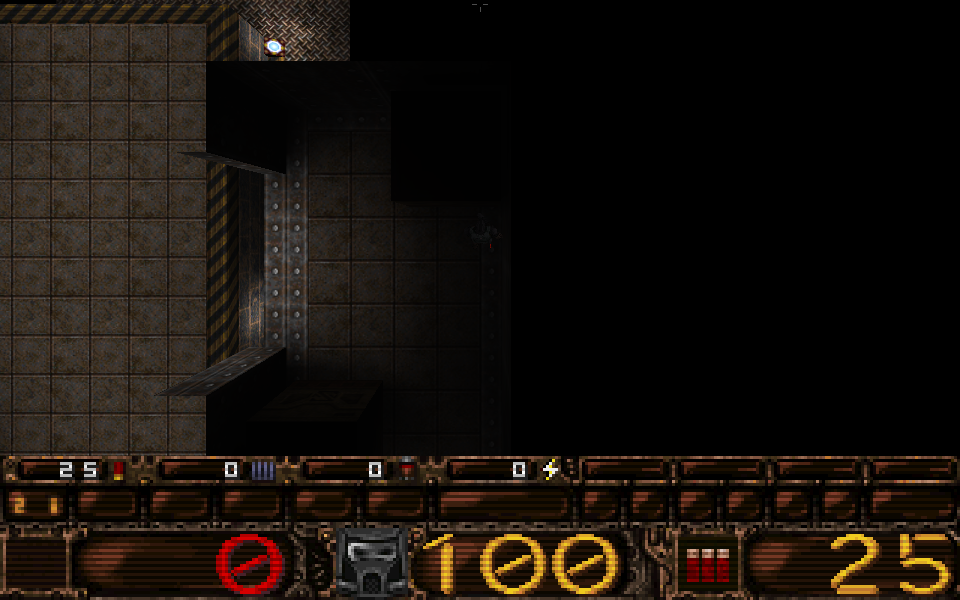

# Quake2D

Jouer à **Quake** en **vue du dessus**, façon *GTA 1/2*, avec son vrai moteur 3D :
la caméra du jeu est placée au-dessus du joueur et regarde vers le bas, en
perspective (on voit la face des murs vers les bords de l'écran), les plafonds sont
coupés, et les contrôles deviennent ceux d'un jeu de tir vu du dessus (clavier pour
se déplacer, souris pour viser).

| Combat | Face à un ennemi | Perspective des murs |
|---|---|---|
|  |  |  |

Le mod est une bibliothèque Rust injectée dans
[QuakeSpasm](https://github.com/sezero/quakespasm) au lancement. Le jeu n'est pas
modifié : toute sa logique (monstres, physique, armes, sons, menus) reste celle
d'origine. Les données du jeu viennent de [LibreQuake](https://github.com/lavenderdotpet/LibreQuake),
un remplacement libre et gratuit de Quake, ou de votre propre copie de Quake.

C'est la deuxième étape d'une expérience plus large, après
[2dDOOM](https://github.com/evxn13/2dDOOM) : rendre des jeux 3D jouables en 2D,
notamment sur de petites configurations.

## Pourquoi c'est plus léger

Vu du dessus, le moteur n'a plus à traiter qu'un petit rectangle autour du joueur,
sans plafonds ni étages supérieurs, au lieu de tout ce qu'on voit en perspective
jusqu'au fond d'une salle. Mesuré sur les trois démos de LibreQuake (`timedemo`),
avec OpenGL calculé par le processeur (Mesa llvmpipe, sans carte graphique) :

| Résolution | Sans le mod | Avec le mod | Gain |
|---|---|---|---|
| 640×400 | 13 à 29 images/s | 77 à 128 images/s | **×4,4 à ×5,9** |
| 1280×800 | 11 à 30 images/s | 26 à 43 images/s | ×1,5 à ×2,3 |

Sans le mod, la résolution ne change presque rien : c'est le nombre de surfaces à
traiter qui limite. Avec le mod, ce coût s'effondre et c'est le nombre de pixels
qui devient la limite — baisser la résolution est donc très efficace en vue du
dessus. Ces mesures restent à confirmer sur de vraies petites cartes graphiques.

## Fonctionnalités

- **Vrai rendu 3D vu du dessus** : modèles 3D des monstres et du joueur, éclairage
  et effets d'origine.
- **Perspective façon GTA** : plus un mur est loin du centre de l'écran, plus on
  voit sa face, avec sa vraie texture.
- **Plafonds coupés** juste au-dessus de la tête du joueur.
- **Brouillard de guerre** : les zones invisibles depuis le joueur ne sont pas
  dessinées (grâce aux données de visibilité précalculées de Quake).
- **Contrôles « twin-stick »** : déplacement relatif à l'écran, visée à la souris.
  Si vous ne touchez pas la souris, le personnage regarde là où il marche et le
  viseur s'estompe.
- **Liquides translucides** : on voit ce qui se trouve dans l'eau, la boue ou la lave.
- **Visée verticale automatique** : on ne peut plus viser en hauteur, le jeu s'en
  charge.
- **Son spatialisé selon l'écran** : un bruit à l'est de l'écran sort à droite.
- **Votre configuration n'est pas modifiée** : les réglages du mod sont appliqués
  en mémoire, jamais enregistrés dans `config.cfg`.

## Prérequis

- **Linux x86_64**.
- **Rust 1.88 ou plus récent** — installation : <https://rustup.rs>.
- **git, make, un compilateur C, pkg-config, curl, unzip, SDL2, libvorbis, OpenGL** —
  `install.sh` peut les installer pour vous (Arch, Debian/Ubuntu, Fedora).

## Installation

```sh
git clone https://github.com/evxn13/Quake2D.git
cd Quake2D
./install.sh          # ou ./install.sh --deps pour installer les dépendances
```

Le script :

1. vérifie les dépendances ;
2. télécharge et compile **QuakeSpasm 0.96.3** dans `build/` (avec ses symboles de
   débogage, dont le mod a besoin pour trouver les fonctions du jeu) ;
3. compile le mod (`target/release/libquake2d.so`) ;
4. télécharge **LibreQuake v0.09-beta** (116 Mo, empreinte SHA-256 vérifiée) dans
   `data/librequake`.

Pour jouer avec votre copie de **Quake** à la place de LibreQuake, indiquez le
dossier qui contient `id1/pak0.pak` :

```sh
./install.sh --data ~/.local/share/Steam/steamapps/common/Quake
```

## Jouer

```sh
./run.sh                          # menu principal
./run.sh +skill 1 +map lq_e1m1    # directement au premier niveau, difficulté facile
```

### Contrôles

| Action | Touches |
|---|---|
| Se déplacer (haut = vers le haut de l'écran) | **ZQSD** (AZERTY) / **WASD** (QWERTY) ou flèches |
| Marcher au lieu de courir | **Maj** |
| Viser | **souris** (le personnage se tourne vers le viseur) |
| Tirer | **clic gauche** |
| Sauter / nager vers le haut | **Espace** |
| Changer d'arme | **1** à **8** |
| Menu | **Échap** |

Dans Quake, les portes s'ouvrent en s'en approchant et les boutons en les touchant
ou en tirant dessus.

## Réglages

Par variables d'environnement, par exemple `QUAKE2D_VIEW=400 ./run.sh` :

| Variable | Effet | Défaut |
|---|---|---|
| `QUAKE2D_VIEW` | largeur de la vue en unités de carte (plus petit = plus proche) | `600` |
| `QUAKE2D_HEIGHT` | hauteur de la caméra au-dessus des yeux (plus bas = perspective plus marquée, `0` = sans perspective) | `250` |
| `QUAKE2D_CLIP` | hauteur de coupe au-dessus des yeux, en unités | `40` |
| `QUAKE2D_MOUSE_SENS` | sensibilité du viseur | `1` |
| `QUAKE2D_LIQUID_ALPHA` | opacité de l'eau, de la boue et de la lave (0 à 1) | `0.5` |

## Dépannage

**Le jeu se lance en vue normale.** Le mod ne s'est pas activé : le message
`[quake2d] vue du dessus activée` n'apparaît pas dans le terminal. Lancez le jeu
avec `./run.sh` après `./install.sh`, et non avec un QuakeSpasm installé par votre
distribution.

**L'image est sombre.** Quake est un jeu sombre, et la vue du dessus montre surtout
des sols. Augmentez la luminosité dans le menu des options, ou dans la console
(touche `²` ou `~`) avec par exemple `gamma 0.7`.

**Impossible de viser au pavé tactile en se déplaçant.** La plupart des bureaux
désactivent le pavé tactile pendant la frappe. Sous **Hyprland**, `run.sh` désactive
ce comportement le temps de la partie puis le rétablit. Sous GNOME ou KDE,
désactivez l'option correspondante dans les paramètres de la souris.

## Limites connues

- Les démos fournies par LibreQuake ne suivent pas le joueur : la vue reste fixe
  et le joueur n'apparaît pas.
- Les liquides ne sont translucides que si la carte a été compilée pour ; ce
  réglage n'a pas encore été vérifié en jeu.
- Uniquement QuakeSpasm 0.96.3 sous Linux x86_64. Le multijoueur n'a pas été testé.

## Comment ça marche

`run.sh` lance QuakeSpasm avec `LD_PRELOAD=libquake2d.so`. On ne réécrit pas le
rendu : on remplace quelques petites fonctions du moteur par un saut vers les
nôtres.

| Fonction du jeu | Ce que fait le mod |
|---|---|
| `R_SetFrustum` | monte la caméra au-dessus du joueur et la tourne vers le bas, et remplace les 4 plans d'élimination par les bords du rectangle visible — le moteur ne traite plus que ce qui est à l'écran |
| `GL_SetFrustum` | perspective vue d'en haut : la caméra regardant droit vers le bas, son plan de coupe proche est horizontal, et placé juste au-dessus des yeux il supprime plafonds et étages supérieurs |
| `CL_BaseMove` | fabrique la commande du joueur à partir du clavier et du viseur |
| `V_RenderView` | encadrée (on restaure ses octets le temps de l'appel) pour dessiner le viseur |
| `Chase_UpdateForDrawing` | neutralisée : la caméra de poursuite fait dessiner le joueur, sans déplacer la caméra |

Le clavier et la souris sont lus directement dans SDL, et quelques variables de
console sont réglées à chaque image (caméra de poursuite, souris du jeu, arme à
l'écran, visée automatique, transparence des liquides).

### Rétro-ingénierie

Les adresses ont été retrouvées sur un binaire **sans symboles** avec
[REA](https://github.com/morluto/rea) et Ghidra, puis vérifiées contre les
symboles. Elles servent de solution de secours quand les symboles sont absents
(`mod/src/profile.rs`).

| Élément | Point de départ |
|---|---|
| `GL_SetFrustum` | unique appelant de la fonction OpenGL importée `glFrustum` |
| Variables de console | une variable commence par un pointeur vers son nom : la relocation qui vise la chaîne du nom donne son adresse |
| `R_SetFrustum` | lit la variable `r_stereo` ; elle écrit `frustum` et lit `r_origin`, `vpn`, `vright`, `vup` |
| `r_refdef`, `AngleVectors` | dans `R_SetupView`, l'unique appelant de `R_SetFrustum` |
| `CL_BaseMove` | lit la variable `cl_upspeed` |
| `Chase_UpdateForDrawing` | lit la variable `chase_back` |
| `cl` | `CL_SendMove` (« CL_SendMove: lost server connection ») incrémente son premier champ |
| `Cbuf_AddText` | chaîne « Cbuf_AddText: overflow » |

## Développement

```
mod/src/
  lib.rs      détours et caméra
  profile.rs  adresses du jeu (symboles ou profil REA)
  input.rs    contrôles clavier + souris (SDL)
  gl.rs       fonctions OpenGL utilisées (projection, viseur)
  module.rs   exécutable en mémoire, détour par saut
  symbols.rs  lecture de la table des symboles
bench.sh      mesure timedemo avec ou sans le mod
```

```sh
cargo test --release
./bench.sh mod 640 400 demo1 demo2 demo3     # ou « base » pour le jeu sans mod
```

Variables utiles pour le développement : `QUAKE2D_DEBUG=1` (commandes envoyées au
jeu), `QUAKE2D_SHOTS=100,300` (captures d'écran à ces numéros d'image),
`QUAKE2D_QUIT_AFTER=400` (quitter après N images).

## Crédits

- *Quake* © id Software. Aucune donnée du jeu n'est fournie par ce dépôt.
- [QuakeSpasm](https://github.com/sezero/quakespasm) (GPL-2.0) et
  [LibreQuake](https://github.com/lavenderdotpet/LibreQuake), téléchargés par
  `install.sh`.
